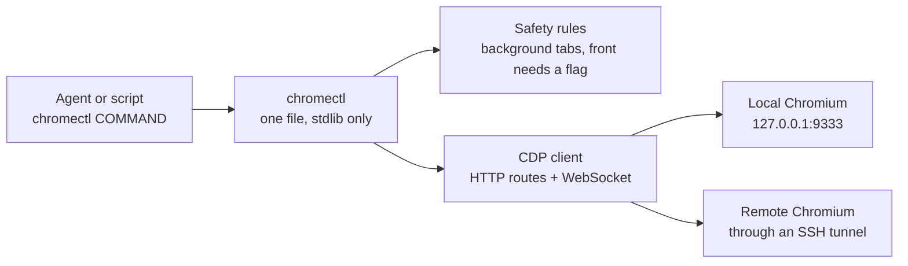

# kodros-chromectl

A one-file command line tool that lets an agent or script drive a Chromium you already have open. It talks to the browser over the Chrome DevTools Protocol on loopback. It opens tabs in the background, reads page text, clicks, types, takes screenshots and closes tabs by id.

## Hardware and on-prem

- It runs on any machine with Python 3 and a Chromium. No GPU and no server. It needs a Chromium with the DevTools port open on loopback.
- Nothing leaves the machine by default. It connects to `127.0.0.1` only. A second machine is reached through your own SSH tunnel, and you name that host yourself.
- It makes no calls to any cloud service. It is a plain client for the DevTools Protocol.

## How it works



Start Chromium with `--remote-debugging-port=9333 --remote-debugging-address=127.0.0.1`. The tool speaks CDP through the standard HTTP routes plus a small RFC 6455 WebSocket client written in the file. For a second machine it opens an SSH tunnel to that machine's loopback port.

Two rules protect the person using the browser. `open` always creates a background tab, so nothing steals focus. `front` changes what they see, so it refuses unless you pass `--owner-visible`, and it refuses before it connects.

## Stack

Python 3 standard library only. No dependencies.

## Build and run

```bash
git clone https://github.com/thefiredev-cloud/kodros-chromectl.git
cd kodros-chromectl
python3 -m unittest -v                  # 41 tests against an in-process CDP stub
./chromectl status
./chromectl open https://example.com    # prints a short tab id
./chromectl text <id>
./chromectl close <id>
```

Run `./chromectl` with no arguments for the full command list. [BUILD.md](BUILD.md) covers Chromium flags, the remote host and every setting.

## Limits

- It controls one browser per host and has no session or profile handling.
- Key input covers Enter, Tab, Escape, Backspace and the arrow keys. Other keys go in as typed characters.
- The remote host needs key-based SSH. The default `browser-host.example.com` is a placeholder: set `CHROMECTL_REMOTE`.
- The tests never touch a real browser. A socket guard fails any test that connects outside the stub.

## License

Copyright 2026 Tanner Osterkamp. All rights reserved. See [LICENSE](LICENSE). The source is public to read; ask before reuse.
